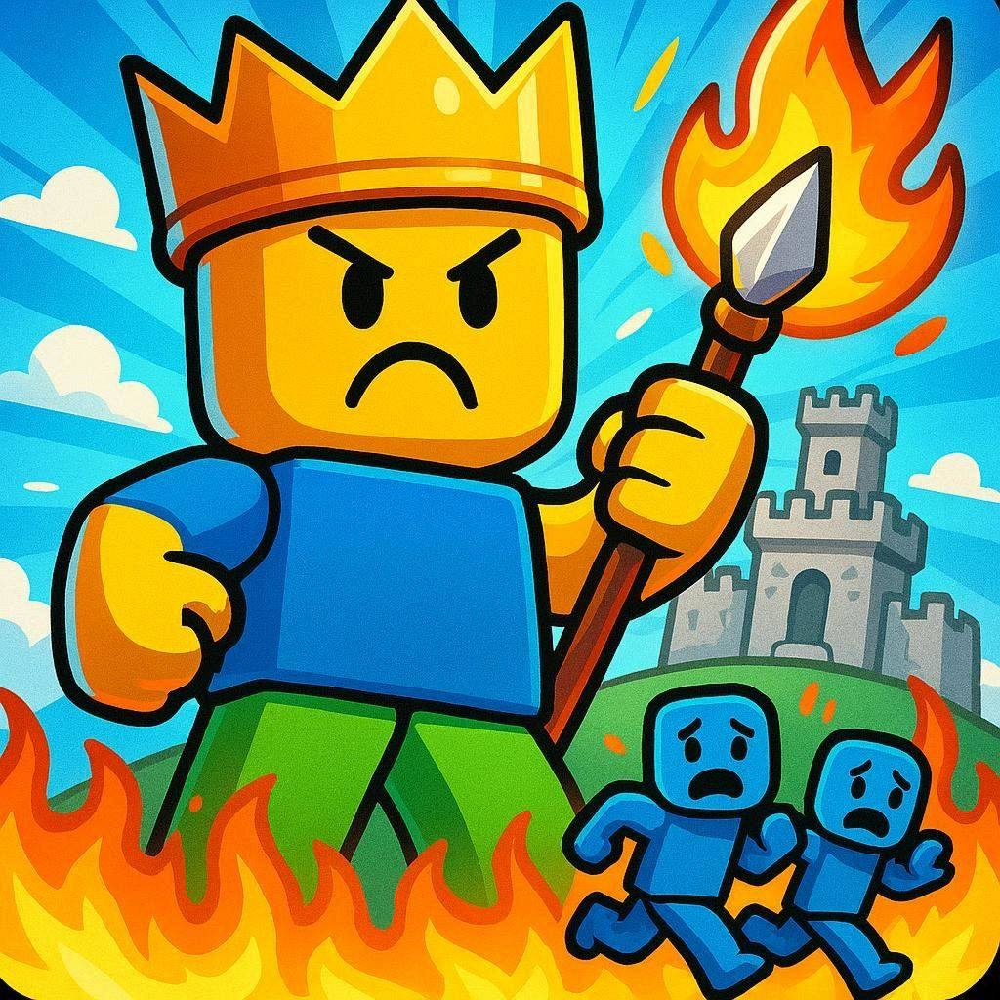

# King vs Runners



A Roblox **asymmetric PvP game** I built and ran entirely on my own.
One King defends a castle while up to 11 Runners try to break through the hill and take it.

> 🎮 **Play:** [King vs Runners on Roblox](https://www.roblox.com/share?code=0bc50ea9a1935841aeb89322d68ef9e6&type=ExperienceDetails)
> 📅 Launched 2026-08-18 · 12-player servers · ~2.5-minute rounds · mobile-first

| | |
|---|---|
| Team | Solo (design, programming, UI, VFX, live ops) |
| Language | Luau (Roblox) |
| Code size | 283 scripts · ~100k lines |
| Ops | Live service: update patches, balancing, telemetry-based tuning · 6.9K total visits |

---

## Gameplay

1. **Stage 1 — Break through:** The King rolls and throws items (barrels, logs, spears, tsunamis, black holes, and more) down the hill from the top of the castle. Runners dodge them and climb.
2. **Stage 2 — Capture or kill:** Once a Runner reaches the top, melee PvP begins. Runners win by filling a capture zone or bringing the King down. When time runs out, the King wins.
3. **When players are short:** AI Runner bots fill the crowd, and if you're the only player in the server, an AI King (3 difficulty tiers) takes the role.

---

## Repo layout

`src/` mirrors the Roblox Studio explorer tree as-is.

```
src/
├─ ServerScriptService/   # Server logic (rounds, data, AI, combat, economy) — 103 files
├─ ServerStorage/
│  ├─ RunnerItem/         # Runner weapons (swords, hammers, gauntlet, bow, ODM gear, …)
│  └─ TaggerItem/         # King's throwable items (bear trap, frost dragon, …)
├─ ReplicatedStorage/     # Shared config/data modules, push tool
├─ StarterPlayer/         # Client scripts (input, camera, HUD, store)
├─ StarterGui/            # UI scripts (inventory, shop, skill bar, spectate, …)
└─ Workspace/             # Lobby objects (leaderboards, training dummies)
```

- File names follow [Rojo](https://rojo.space) conventions: `.server.luau` = Script, `.client.luau` = LocalScript, `.luau` = ModuleScript. A script with child scripts becomes a folder with `init.*.luau`.
- This repo is a **code export**. Models, maps, and UI layouts live in the place file, so this code alone won't build the game.

---

## Main systems

| Area | System | File |
|---|---|---|
| Round | Round state machine, team assignment, win conditions, bot top-up | [`RoundSystem`](src/ServerScriptService/RoundSystem.server.luau) |
| | Stage 2 transition, capture zones | [`Stage2TriggerSystem`](src/ServerScriptService/Stage2TriggerSystem.server.luau) · [`CaptureSystem`](src/ServerScriptService/CaptureSystem.server.luau) |
| AI | AI King: tiered throw patterns, threat (aggro) tracking | [`TaggerBotSystem`](src/ServerScriptService/TaggerBotSystem.server.luau) |
| | AI Runners: pathfinding, item dodging, stuck recovery | [`RunnerBotDriveController`](src/ServerScriptService/RunnerBotDriveController.server.luau) |
| Combat | Item damage, knockback, CC resistance | [`ItemDamageSystem`](src/ServerScriptService/ItemDamageSystem.server.luau) · [`TaggerCcGuard`](src/ServerScriptService/TaggerCcGuard.server.luau) |
| | Single owner for movement state (speed, jump, stun) | [`WalkSpeedManager`](src/ServerScriptService/WalkSpeedManager.server.luau) |
| | Melee weapons (charge, combos, counters) | [`RunnerItem/`](src/ServerStorage/RunnerItem) |
| Data | Session-locked save (ProfileStore), audit logging | [`DataService`](src/ServerScriptService/DataService.server.luau) · [`DataStoreAudit`](src/ServerScriptService/DataStoreAudit.server.luau) |
| Economy | Shop, Battle Pass, quests, daily rewards, skins | [`ShopSystem`](src/ServerScriptService/ShopSystem.server.luau) · [`BattlePassSystem`](src/ServerScriptService/BattlePassSystem.server.luau) · [`QuestSystem`](src/ServerScriptService/QuestSystem.luau) · [`SkinManager`](src/ServerScriptService/SkinManager.server.luau) |
| Ops | Per-round telemetry, death heatmap, onboarding funnel, error logging | [`RoundTelemetry`](src/ServerScriptService/RoundTelemetry.server.luau) · [`DeathHeatmapSystem`](src/ServerScriptService/DeathHeatmapSystem.server.luau) · [`OnboardingFunnel`](src/ServerScriptService/OnboardingFunnel.server.luau) |
| UI | Unified inventory, mobile/PC responsive scaling | [`UnifiedInvenClient`](src/StarterGui/NewGui/UnifiedInven/UnifiedInvenClient.client.luau) · [`ResponsiveScaler`](src/ReplicatedStorage/ResponsiveScaler.luau) |

---

## Problems I hit and how I solved them

### 1. Stacked stuns left the King permanently frozen → a single owner for movement state
Each weapon was saving the King's `WalkSpeed` on its own and restoring it later. When two slams overlapped, one would save `0` as "the original value," restore it when it expired, and the King stayed at speed 0 forever.
A full search found **97 direct `.WalkSpeed =` assignments across 29 scripts**.
→ I built [`WalkSpeedManager`](src/ServerScriptService/WalkSpeedManager.server.luau), where each system only registers a *multiplier* under its own source name, and the real assignment happens in one place only. Jumping, PlatformStand, and the Stunned flag were moved under the same source as well, which removed three separate copies of expiry-token code.

### 2. Purchased skins vanished on rejoin, and the group reward could be claimed repeatedly → moved state into the save data
Equipped skins and the "reward claimed" flag lived only in in-memory server tables, so they reset whenever the server closed or the player rejoined. For a paid item, that's a critical bug.
→ I moved them into the [`DataService`](src/ServerScriptService/DataService.server.luau) profile schema and filled in existing players' data with `Reconcile()`, with no separate migration.

### 3. Round length tuned from measured data instead of gut feel
I first set the round to 180s, then shortened it to 120s after finding in the logs that no round ever ran to 180s. That left too little time for Stage 2 (68–82s after subtracting Stage 1), so the King won on time almost by default. After measuring again, I settled on 150s.
Every decision is recorded with its date and the measured numbers in the comments at the top of [`RoundSystem`](src/ServerScriptService/RoundSystem.server.luau).
→ To keep measuring like this, I added per-round telemetry, a death-location heatmap, and an onboarding funnel.

### 4. AI King: picking a target with a threat score
If the bot only targets the nearest enemy, players can hide and sneak in only the killing blow. I added threat points proportional to damage dealt, with half-life decay, so the King turns toward whoever is actually hitting it ([`TaggerBotSystem`](src/ServerScriptService/TaggerBotSystem.server.luau)).

---

## Third-party code

- **[ProfileStore](https://github.com/MadStudioRoblox/ProfileStore)** by loleris (MAD STUDIO) — session-locked DataStore library ([`ProfileStore.luau`](src/ServerScriptService/ProfileStore.luau))
- **Bear trap** — modified from the trap by TheDrakCarlos (credit kept in the script header)

Unmodified toolbox scripts (Roblox default `Animate`, Quenty's weld scripts, etc.) and backups/test scripts are left out of this repo. Details are in [`docs/EXPORT_NOTES.md`](docs/EXPORT_NOTES.md).
