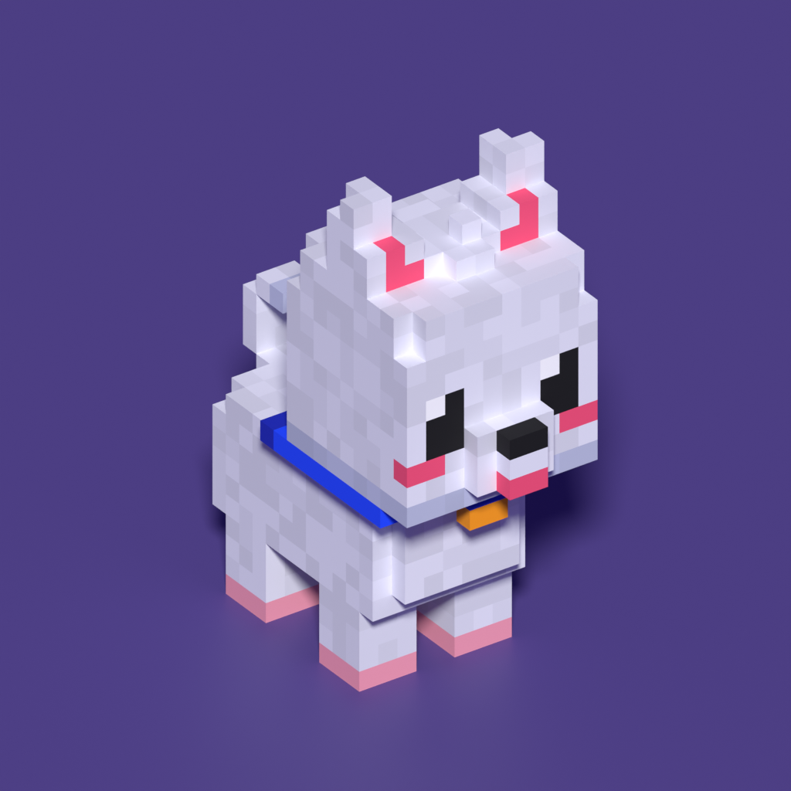

# White Puppy (voxel test pet)

- `WhitePuppy.fbx`: 7 meshes (Body, Head, Tail, LegFL/FR/BL/BR), each with its pivot at the joint so it can be animated from code. About 3,100 triangles.
- `WhitePuppy_Palette.png`: palette texture (apply it as the TextureID / SurfaceAppearance ColorMap on every MeshPart).
- To regenerate: `python tools/blender/white_puppy.py assets/pets/white_puppy --render` (needs `pip install bpy`).

Roblox import: Studio → Avatar/Home → Import 3D → WhitePuppy.fbx. Adjust Scale in the importer if needed (1 voxel = 0.1 m in Blender).
